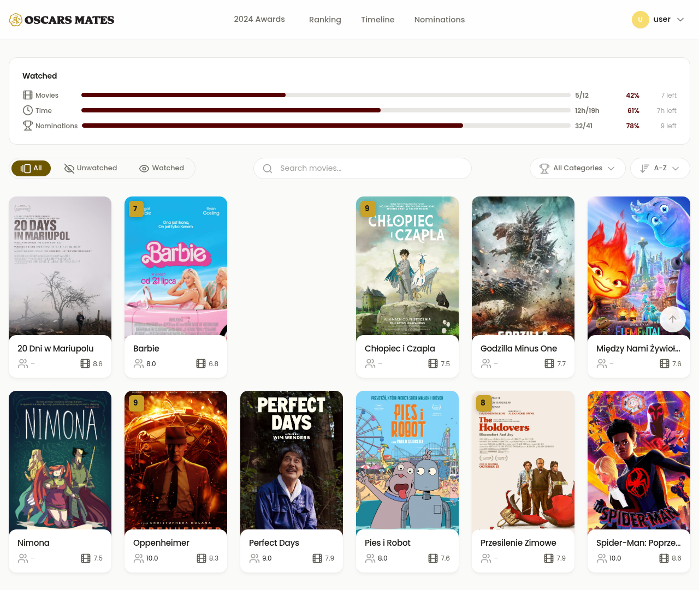
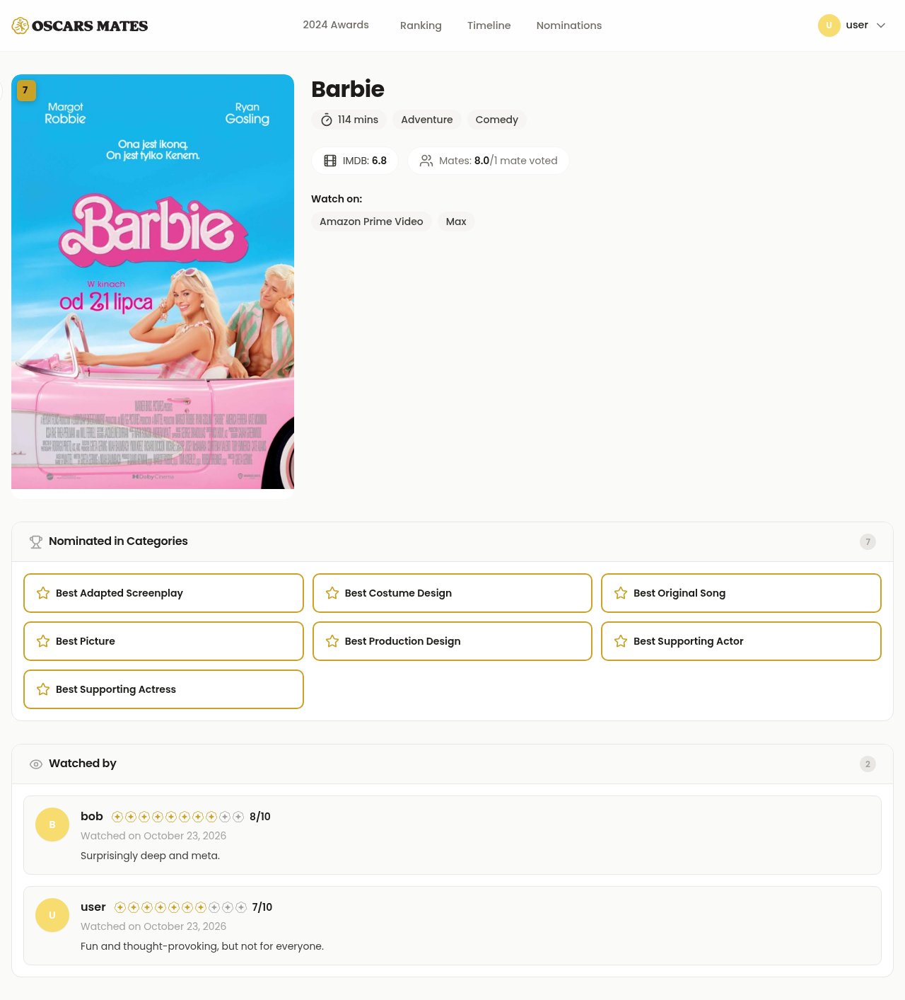
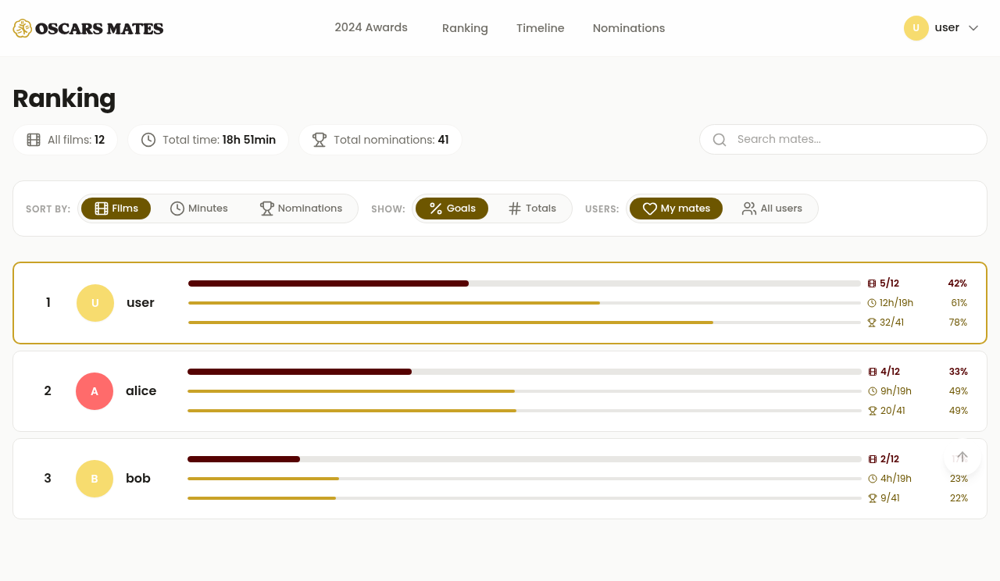
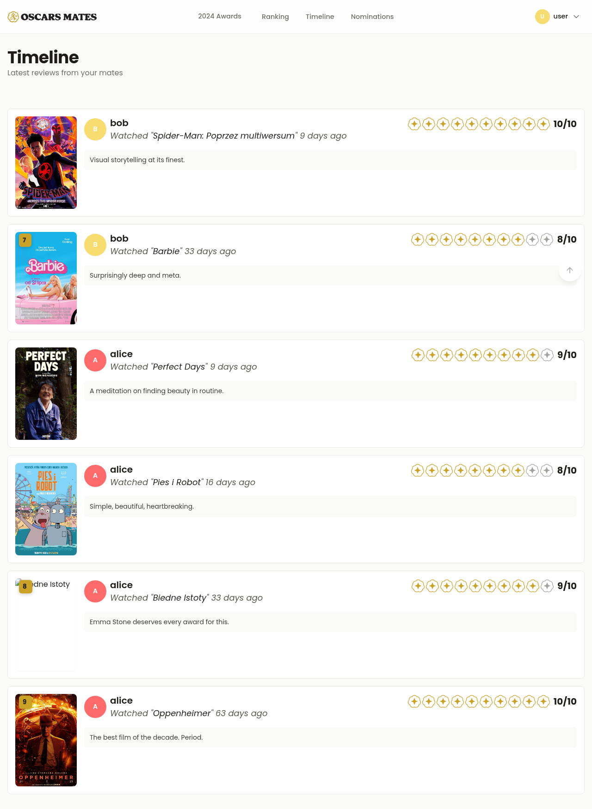

# OscarsMates

OscarsMates is a web app built with Ruby on Rails to help you track your journey through Oscar-nominated films. Mark what you have watched, rate and review every movie, follow your friends, and compete to see who can watch the most before the ceremony.

## Screenshots

| Movies index | Movie details |
|:---:|:---:|
|  |  |

| Mates ranking | Timeline |
|:---:|:---:|
|  |  |

## Key Features

- **Track watched movies** — mark movies as watched, filter by status, and follow your progress for each awards year.
- **Rate and review** — share ratings and personal thoughts for every movie you watch.
- **Mates ranking** — compare progress with friends you follow: films, minutes, and nominations, in two modes (goals vs. totals).
- **Timeline and stats** — see everyone's reviews in chronological order and visualize watched minutes on interactive charts.
- **Predict the winners** — pick your favorites in each category and see vote counts from your mates.
- **Search, filter, and sort** — find any nominated film fast, across categories and streaming services.
- **Dark mode** — because late-night movie marathons happen.

## Tech Stack

- **Ruby on Rails 8.1** (Ruby 3.3), SQLite, Hotwire (Turbo + Stimulus) for interactivity without a separate frontend
- **Tailwind CSS** with a custom design system: brand color palettes (Red Carpet, Oscar Gold, Teal) as CSS variables shared across every component
- **Chart.js** for stats, **Sidekiq** for background jobs, **esbuild** for the JS bundle
- **Docker Compose** for local development and production parity

## Engineering Notes

A few notes on how the project is built and maintained:

- **~200 RSpec examples** (model, request, and system specs with FactoryBot) plus JavaScript linting
- **CI on every pull request**: RuboCop, Brakeman (security scan), `database_consistency` (schema ↔ model checks), and the full test suite
- **Protected `main` branch**: merges require green checks, linear history, and up-to-date branches
- **Service and query objects** (`RankingService`, `ListMoviesQuery`) keep controllers thin and business logic testable
- **Security care**: remember-me cookies store a per-user token that rotates on password change, with `httponly` and `SameSite=Lax` flags; a minimum password length is enforced
- **Dependencies kept up to date** with Dependabot, including the Rails 7.1 → 8.1 upgrade

## Contributing

Want to contribute? Feel free to submit a pull request! If you have any bug fixes or ideas for new features, I'd love to see how you'd improve OscarsMates.

Built with ❤️ and Ruby on Rails
